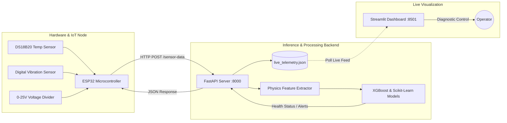

# 🏭 ESP32 AI-Powered Predictive Maintenance System

[](https://www.python.org/)
[](https://fastapi.tiangolo.com/)
[](https://streamlit.io/)
[](https://www.espressif.com/)
[](https://xgboost.readthedocs.io/)
[](LICENSE)

An end-to-end industrial IoT and machine learning predictive maintenance pipeline. Sensor readings collected from an **ESP32 microcontroller** (surface temperature, mechanical shock/vibration, and machine voltage) are streamed in real time over Wi-Fi to a **FastAPI backend**. A trained **XGBoost machine learning model** computes failure probabilities, identifies specific failure modes, and broadcasts real-time telemetry and diagnostics to an interactive **Streamlit dashboard**.

---

## 🏗️ Architecture Overview



---

## ⚡ Key Features

- **Real-Time IoT Telemetry**: ESP32 continuously samples sensor data and streams JSON payloads over Wi-Fi every 3 seconds.
- **Physics-Informed Feature Engineering**: Computes derived metrics including `stress_index`, `voltage_deviation`, and `temperature_anomaly` before model evaluation.
- **Multi-Level Fault Diagnosis**:
  - **Binary Machine Health**: Identifies overall status (`NORMAL`, `WARNING`, `CRITICAL`).
  - **Failure Mode Classification**: Pinpoints the exact failure mechanism:
    - 🔴 **VAF** (Vibration Abnormal Failure)
    - 🔴 **OHF** (Overheating Failure)
    - 🔴 **VLF** (Voltage Level Failure)
    - 🔴 **CSF** (Combined Stress Failure)
- **Interactive Streamlit Web UI**:
  - Live ESP32 telemetry feed with real-time health indicator gauges.
  - Interactive simulator to test hypothetical sensor parameters.
  - Batch CSV scoring for offline telemetry analysis.
  - ML diagnostic charts including ROC-AUC curves, feature importances, and model comparisons.
- **Edge Alert Feedback**: The API sends immediate alert status back to the ESP32 in the HTTP response body to trigger onboard warning LEDs (GPIO 2).

---

## 🔌 Hardware Pinout & Wiring

| Sensor Module | Sensor Pin | ESP32 Pin | Wiring / Connection Notes |
| :--- | :--- | :--- | :--- |
| **DS18B20 (Temperature)** | `VCC` | `3.3V` or `5V` | Power supply |
| | `GND` | `GND` | Common Ground |
| | `DATA` | **`GPIO 4`** | **Requires 4.7 kΩ pull-up resistor** between DATA and VCC |
| **Digital Vibration Sensor** | `VCC` | `3.3V` or `5V` | Power supply |
| | `GND` | `GND` | Common Ground |
| | `DO` (Digital Out) | **`GPIO 27`** | Digital signal (`0` = quiet, `1` = shock/vibration) |
| **Voltage Sensor (0-25V)** | `VCC` / `+` | Machine Supply `+` | Measures up to 25V DC (Nominal 12V DC) |
| | `GND` / `-` | Machine Supply `-` | Common Ground with ESP32 |
| | `S` (Signal Out) | **`GPIO 34`** | ESP32 ADC Input (Reads 0–4095) |
| **Alert Indicator** | Onboard LED | **`GPIO 2`** | Illuminates when ML backend flags `CRITICAL` risk |

---

## 📂 Project Directory Structure

```text
miniproject-predictive-maintenance/
├── api_server.py                 # FastAPI backend for real-time model scoring
├── app.py                        # Streamlit web dashboard
├── ESP32_Hardware_Team_Handoff.md# Hardware pinout and wiring specifications
├── live_telemetry.json           # Cached live telemetry buffer
├── predictive_maintenance.csv    # Synthetic machine dataset for training
├── requirements.txt              # Python project dependencies
├── .gitignore                    # Git ignore file
├── esp32_firmware/
│   └── esp32_firmware.ino        # ESP32 C++ Arduino firmware
├── models/
│   ├── best_model.joblib         # Trained primary model (XGBoost)
│   ├── failure_mode_models.joblib# Multi-output failure mode classifiers
│   ├── metrics_summary.json      # Model performance metrics & ROC-AUC
│   └── scaler.joblib             # Feature standardizer
└── src/
    ├── data_preprocessing.py     # Data cleaning and feature engineering
    ├── generate_dataset.py       # Synthetic dataset generation tool
    └── train_model.py            # Model training & serialization pipeline
```

---

## 🚀 Getting Started

### 1. Prerequisites
- Python 3.10, 3.11, 3.12, or 3.13
- Arduino IDE (with ESP32 board support and libraries: `OneWire`, `DallasTemperature`, `ArduinoJson`)

### 2. Install Dependencies
```bash
# Clone the repository
git clone https://github.com/vipuleshj-web/miniproject-predictive-maintenance.git
cd miniproject-predictive-maintenance

# Install required Python packages
pip install -r requirements.txt
```

### 3. Flash ESP32 Firmware
1. Open [`esp32_firmware/esp32_firmware.ino`](esp32_firmware/esp32_firmware.ino) in Arduino IDE.
2. Update your Wi-Fi credentials:
   ```cpp
   const char* WIFI_SSID     = "YOUR_WIFI_SSID";
   const char* WIFI_PASSWORD = "YOUR_WIFI_PASSWORD";
   ```
3. Update `API_URL` with your workstation's local IP address:
   ```cpp
   const char* API_URL = "http://192.168.1.X:8000/sensor-data";
   ```
4. Select board **ESP32 Dev Module** and upload the sketch.

### 4. Run the Machine Learning API Backend
```bash
python api_server.py
```
*API server will start on `http://0.0.0.0:8000`. Interactive API documentation available at `http://localhost:8000/docs`.*

### 5. Launch the Streamlit Monitoring Dashboard
In a new terminal window:
```bash
streamlit run app.py
```
*Access the dashboard at `http://localhost:8501`.*

---

## 🧠 Machine Learning Model Pipeline

1. **Features Extracted**:
   - `temperature`: Surface reading in °C.
   - `vibration`: Binary mechanical shock indicator.
   - `voltage_adc`: 12-bit ADC raw output.
   - `voltage_volts`: Converted voltage supply level ($V$).
   - `stress_index`: Combined mechanical and thermal stress interaction term.
   - `voltage_dev`: Absolute deviation from nominal 12.0V operating voltage.
   - `temp_anomaly`: Thermal surge magnitude relative to normal operating bounds.
2. **Models Evaluated**:
   - XGBoost Classifier (Selected as primary model)
   - Random Forest Classifier
   - Logistic Regression Baseline
3. **Metrics**:
   - High ROC-AUC and F1-score balanced using SMOTE oversampling to account for infrequent industrial hardware faults.

---

## 📄 License
This project is open-source under the [MIT License](LICENSE).
